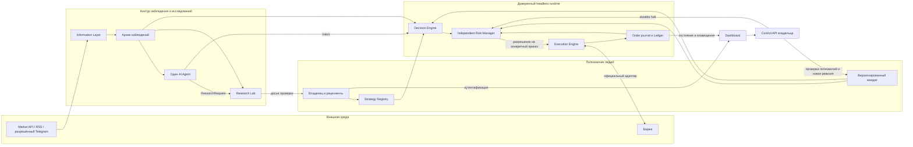
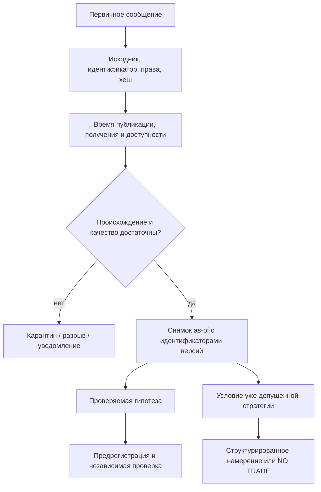
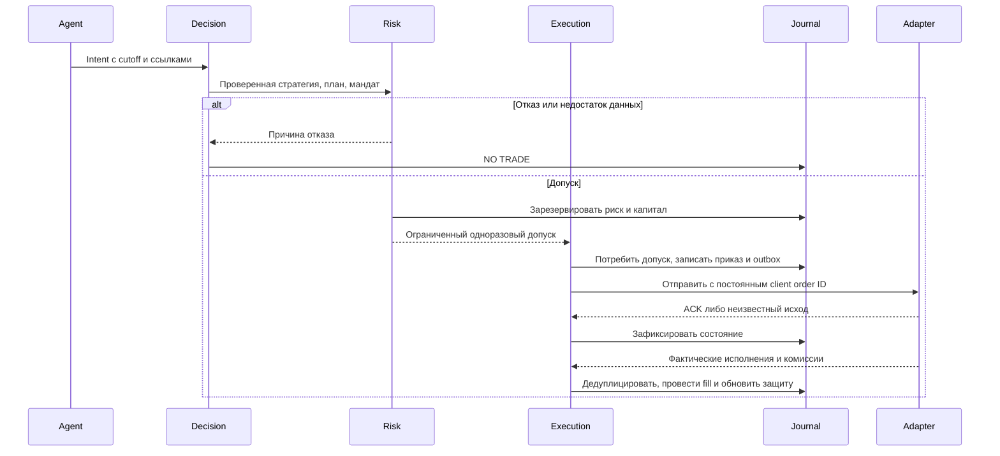

# Целевая архитектура

**Статус — проект.** На первом сервере достаточно одного headless-сервиса с единственным владельцем исполнения на счёт, транзакционного хранилища SQLite на локальном диске, отдельного исследовательского процесса и клиентского UI. Компоненты ниже — логические границы. Агент и загрузчики недоверенного контента работают без доступа к закрытой сети исполнения, ключам и файлам финансового журнала. Перенос логики в разные классы одного процесса сам по себе такой изоляции не даёт. [Текущее состояние](BASELINE_AUDIT.md)

## Компоненты и границы доверия

| Компонент | Вход → выход и владелец записи |
|---|---|
| Information Layer | Public market feed, allowlist API/RSS/официальных публикаций, разрешённые каналы → неизменяемые наблюдения и статусы качества. Сборщик сохраняет оригинал или разрешённую ссылку/хеш по лицензии, нормализованные поля, версию парсера, признаки коррекции и пропуска. |
| Autonomous AI Agent | Читаемые as-of снимки, реестр, исследовательская память → ResearchRequest, Intent или NO TRADE. Процесс получает квоты времени, токенов и запросов. |
| Research & Strategy Lab | Зафиксированные гипотезы и датасеты → воспроизводимые отчёты, неопределённость, список неудачных попыток. Реестр принимает смену статуса только от разрешённых ролей. |
| Decision Engine | Строго типизированное намерение, мандат, одобренная версия и признаки → проверенное решение либо отказ. Сам вычисляет условие стратегии и доступность каждого входа на момент решения. |
| Independent Risk Manager | Решение, свежий снимок балансов, позиция, pending orders, состояние защиты и правила инструмента → отказ с кодом либо однократный допуск и резерв. |
| Execution Engine | Допуск и резерв → durable order, события исполнения и сверки. Только адаптер выбранной среды может направлять приказ; учёт закрывает резерв по фактам исполнения. |
| Runtime & Infrastructure | Входные события и команды → восстановимое состояние, очередь, heartbeat, безопасный режим. Исполнитель владеет единственным писателем на счёт. |
| Dashboard | Читаемые проекции и уведомления → отображение капитала, риска, сделок, решений, новостей и гипотез. Изменения мандата направляет через аутентифицированный control API, без прямой записи в SQLite. |

## От наблюдения до намерения

Событие содержит event_id, source_id, время площадки/публикации, first_received_at, available_at, processed_at, ссылку на оригинал, версию и качество часов. Везде UTC; локальные длительности измеряются монотонными часами внутри процесса. При коррекции добавляется запись supersedes. Перепечатки группируются по первоисточнику. Для решения доступны только наблюдения, реально доступные до cutoff. Отображение в браузере, поздний REST backfill и время статьи сами по себе не доказывают момент знания.

## Решение, заявка и факт

**Атомарность.** В одной локальной транзакции Risk проверяет ревизии и создаёт резерв. В другой исполнитель сверяет текущую версию мандата, состояние остановки, свежесть, epoch владельца и TTL допуска, затем связывает резерв с одним приказом и outbox. После истечения неиспользованного допуска резерв снимается атомарно. Приказ с возможной отправкой удерживает резерв до подтверждённого исхода. Сбой между записью и сетью неизбежен; достигать однократного финансового эффекта через стабильный client_order_id, поиск на площадке и уникальный execution_id. Перед сетевой отправкой повторно проверить stop/epoch; уже находящаяся в сети заявка попадает в сверку при остановке.

**Хранилища.** Отдельно держать исходные наблюдения, исследовательские результаты, реестр/мандаты и журнал каждого исполнения. В финансовом журнале связать decision_id, risk_grant_id, client_order_id, exchange_order_id и venue execution_id с account_id и mode. Прогноз — отдельная публикация с model_version, горизонтом и as-of. Владелец может пройти от проводки до исходных данных. Исправление учёта оформляет новую компенсирующую запись с автором и причиной. Финансовые поля — Decimal, кванты биржи и валюта комиссии фиксируются в момент события.

**Контракт адаптера.** prepare/submit, cancel, lookup_by_client_id, list_open_orders, fetch_fills_since, fetch_balances и verify_protection имеют раздельные результаты для Local Paper, официального Demo и Restricted Live Spot. Режим определяет программно закреплённую связку account/endpoint/namespace/credentials. Ошибка Demo никогда не переводит вызов в Live. Типичный путь заявки начинается переходами PREPARED → PENDING_SEND → SUBMITTED_UNKNOWN/ACKNOWLEDGED → PARTIALLY_FILLED → FILLED. Возможны REJECTED, CANCEL_PENDING, CANCELLED и EXPIRED. Из UNKNOWN разрешена только сверка до однозначного результата; учесть fill до ACK, fill во время отмены и частично исполненную отменённую заявку. Хранить факты исполнения независимо от транспортного порядка.

**Сверка.** Private WS сообщает об изменениях; REST-проверка открытых заявок, исполнений с перекрытием по курсору, остатков и серверных защитных ордеров разрешает разрывы. Каждый fill одной транзакцией обновляет журнал, cash, base, комиссию, себестоимость, резерв и требуемое покрытие. Покрытие признаётся установленным только по подтверждённому состоянию биржи и продаваемому количеству с учётом dust. При несовпадении остановить входы и показать фактическую незащищённую часть. [Обработка отказов](SAFETY_AND_RISK.md)

**Эксплуатация.** Небольшая durable очередь с последовательностью, лимитом, приоритетом stop/reconciliation и метриками возраста. При переполнении закрыть входы; сообщения о финансовых событиях восстанавливать из журнала площадки. Heartbeat отражает время последнего успешного цикла, последней сверки и версию владельца. На одном хосте начать с OS-lock и транзакционных ревизий; второй исполнитель при старте завершается до записи. Несколько хостов требуют доказанного fencing, включая отключение старого владельца от отправки. Дашборд читает лаг, баланс, queued/unknown orders, подтверждённое покрытие и режим остановки даже после перезапуска. План восстановления включает шифрованную резервную копию, проверку восстановления в изоляции и сверку с площадкой до активации.

## Минимальный контракт между Risk и Execution

| Поле | Проверка перед потреблением |
|---|---|
| grant_id, intent_id, decision_id, canonical_request_hash | Идентификаторы уникальны в mode/account, digest канонического приказа совпадает. Повтор с изменённым телом отклоняется. |
| strategy_id/version, registry_revision, mandate_revision, owner_epoch | Вход требует действующих стратегии и торгового мандата для счёта и площадки. Защитная заявка при остановке требует отдельного действующего разрешения владельца на конкретное действие из плана защиты позиции. В обоих случаях обязательны владение runtime и новый допуск Risk. |
| side, instrument, quantity_base, max_debit_quote, price/slippage_bound, exit_plan_hash | Точные Decimal-строки и единицы. Порог проскальзывания проверяется по возможности адаптера; неподдерживаемая гарантия блокирует приказ. |
| reservation_id, account_revision, quote_id, rules_version, valid_until | Сумма покрыта резервом, котировка/правила и счёт актуальны. Изменившийся риск или истёкший TTL возвращают решение на повторную проверку. |

Допуск доставляется по закрытому каналу runtime и проверяется по сохраняемой записи Risk. Любой идентичный JSON из источника или ответа модели отвергается на границе отправки. При переходе от локального Paper к нескольким процессам модель идентификации сервиса, аудит выдачи и отзыв полномочий входят в security review.
