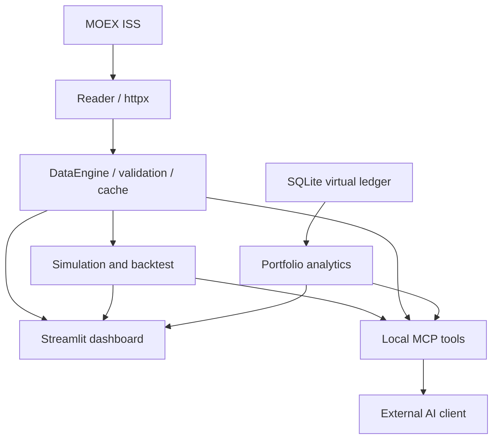

# Архитектура MOEX Intelligence

## Границы системы

Приложение локальное. Внешний источник — публичный MOEX ISS; брокерский доступ и торговые методы отсутствуют. Числа вычисляются Python. Языковая модель подключается внешним MCP-клиентом, а её ответ не используется как источник котировок или результатов моделирования.

Стрелка Portfolio → MCP означает вызов чистого расчёта с явно переданными событиями. MCP не загружает личный SQLite-журнал автоматически. SQLite используется только локальным UI/Python API.

## Структура

| Путь | Ответственность |
|---|---|
| `moex.py` | Сохранённый и расширенный HTTP-клиент Reader, парсер ISS, исходные metrics |
| `server.py` | Совместимый сервер с пятью прежними инструментами |
| `moex_intelligence/data.py` | DataEngine, кеш, карточки/режимы, история и происхождение |
| `time_machine_core/simulator.py` | Сохранённый bootstrap и новые риск-метрики |
| `time_machine_core/moex_data.py` | Совместимый loader поверх DataEngine, явный demo |
| `time_machine_mcp.py` | Bridge API и регистрация двух инструментов |
| `moex_intelligence/backtest.py` | Сигналы, следующий OPEN, лоты/издержки, holdout/benchmark |
| `moex_intelligence/portfolio.py` | Чистые расчёты журнала, TWR, стресс, SQLite storage |
| `moex_intelligence/mcp_factory.py` | Пять совместимых инструментов без общих мутаций серверов |
| `moex_intelligence/mcp_server.py` | Объединённый сервер, 13 инструментов |
| `moex_intelligence/research.py` | Детерминированный отчёт для человека/LLM |
| `moex_intelligence/dashboard.py`, `app.py` | UI; не содержит альтернативных формул расчёта |
| `config.py`, `validation.py` внутри пакета | Окружение, JSON-логирование, числовые ограничения |
| `tests/`, `scripts/` | Регрессии, математика, UI, MCP и явные сетевые smoke |
| `legacy/` | Неизменённые ZIP исходных проектов |

## Контракты данных

### Reader

`ISS.get(path, params) -> (dict, source_url)` — асинхронный единственный сетевой клиент. Timeout 20 секунд на запрос, до трёх попыток, экспоненциальная пауза 0.5/1 секунды при временных ошибках. Редиректы запрещены. Пагинация истории до 40 страниц, остановка на пустой странице, явная ошибка при повторяющихся/неупорядоченных датах или достижении лимита. Тикер и режим валидируются до построения URL.

Исходные методы `quote/history/search/snapshot` сохранены. `quote/history` дополнительно принимают `market='shares'|'bonds'`. История исходного Reader отдаёт исходные строки ISS; строгий DataFrame-контракт применяется DataEngine перед моделированием. LAST остаётся null, если нет сделки; PREVPRICE никогда не подставляется.

### DataEngine

`await engine.frame(symbol, start, end) -> (DataFrame, metadata)`.

- Индекс — уникальные, возрастающие `TRADEDATE`, timezone-naive биржевые даты, без ресемплинга на календарь.
- CLOSE — конечное положительное число на каждой строке. Пропуски, дубликаты и неверные даты отклоняются.
- OPEN/HIGH/LOW/VOLUME и прочие доступные поля сохраняются. Backtest отдельно требует валидные OPEN/CLOSE.
- Никакого `ffill`, удаления невалидных CLOSE и склейки разных торговых режимов.
- Metadata: symbol, name, market, board, asset_type, currency, board_unit, source, retrieved_at_utc, cache, price_adjustment, price_unit, history_sha256, warnings и coverage.
- Кеш: копия результата, монотонный TTL, максимум 64 записи; возвращаемое значение не меняет кеш. Время получения сохраняется на cache hit. Ошибки не кешируются, просроченные значения не подставляются.
- Указанный период ≤3660 дней. Дневные исследования по умолчанию используют конец «вчера по Москве». В API Reader дата задаётся явно.

`frame_sync()` — адаптер для синхронного Streamlit и bridge, реализованный через `asyncio.run`. Его нельзя вызывать прямо в активном async event loop. Объединённый MCP либо вызывает async `frame`, либо отправляет sync-работу в поток.

Отдельные процессы UI/MCP используют общую реализацию и исходный API, но не общий RAM-кеш. Нет скрытого файлового кеша рыночных данных.

### Разные классы инструментов

Акции/фонды: цены за одну бумагу в валюте источника; simulation/backtest ограничены RUB/SUR. Биржевые фонды определяются по TYPE/режиму, а не по названию. История не очищается от дивидендных/сплитовых скачков.

Облигации: рынок `bonds`, primary board и исходные FACEVALUE/ACCRUEDINT сохраняются. Котировка трактуется как процент номинала; не выдаётся за рубли. Купоны/амортизация/погашение не восстановлены автоматически, поэтому облигация отклоняется equity-симулятором и бэктестом. Для виртуального портфеля пользователь явно вводит полную рублёвую цену и документированные денежные выплаты.

### SimulationResult

Сохранены `paths, exits, net_returns, hit_target, hit_stop, still_open, exit_steps, stats`. Добавлен `wealth_paths` — стоимость ликвидируемой позиции с издержками, фиксируемая в день выхода и далее хранимая в бездоходных деньгах.

На каждом шаге bootstrap выбирает непрерывные блоки исторических лог-доходностей. Генератор — локальный `numpy.random.default_rng(seed)`, не глобальное RNG-состояние. История не очищается автоматически. Минимум 65, максимум 10 000 цен.

Односторонняя модель издержек `c = (commission_pct + slippage_pct)/100`; итог `exit × (1-c) / (initial × (1+c)) - 1`. Это упрощённая аддитивная модель. Издержки фиксируются при входе/выходе, не за каждый день. Цель/стоп ценовые, не чистая доходность. Выход при первом закрытии за уровнем или на конце горизонта.

VaR95 = `-quantile(net_returns, .05)`. ES95 = минус среднее `ceil(.05*N)` худших результатов. Метрики в Python — доли единицы, в bridge `risk` — проценты. Volatility — выборочное стандартное отклонение лог-доходностей × √252. Исторический Reader отдельно сохраняет прежнюю формулу на простых доходностях, поэтому значения слегка различаются; это описанные разные методы.

Просадка пути: минимум wealth / running_max(wealth) − 1; база содержит капитал до входа, поэтому включены издержки. Выход прекращает рыночную экспозицию; продолжение исходной ценовой траектории на неё не влияет. `median_strategy_max_drawdown` и `p05_strategy_max_drawdown` — статистики таких просадок по сценариям.

Сравнение: исторические параметры; сдвиг среднего годового лог-изменения −20 п.п. и множитель sigma 1.5; сдвиг +20 п.п. и sigma 1. Используется одинаковый seed. Это анализ чувствительности, не выбор вероятнейшего режима.

### Strategy Lab

Сигналы формируются по закрытию t; сделки — по OPEN t+1. Built-in индикаторы причинные: скользящие средние, RSI с Wilder smoothing и первоначальным SMA. RSI держит состояние: вход при ≤30, выход при ≥70, между порогами состояние не меняется. Первое значение RSI становится доступно после 14 изменений; константная цена даёт RSI=50.

Buy & Hold следует тому же правилу времени входа. Покупаются целые лоты, расход ограничен деньгами. Fill price включает направленное проскальзывание; комиссия начисляется на fill turnover. На последнем CLOSE выполняется плановое закрытие, с теми же издержками. Это запланированный конец теста, а не сигнал из будущего.

Train/test — хронологическое деление. Автоматической оптимизации нет. Test начинается с нового капитала; предыдущие цены доступны только для прогрева индикаторов. Сравнительный Buy & Hold имеет те же даты, капитал, лот и издержки. Пользователь сам фиксирует параметры до просмотра test; платформа не может предотвратить ручную подгонку после многократных запусков.

Custom callable получает копию только доступного исторического префикса и возвращает 0/1. Импорт/исполнение возможны только через доверенный локальный Python. Это не sandbox для чужого кода: функция может обращаться к внешним файлам/сети по своим правам. UI/MCP не принимают произвольный код. Предел 2600 баров для custom и 10000 для встроенных стратегий.

### Portfolio

События: дата ISO, kind, сумма либо ticker/quantity/price, fee, RUB, при выплатах source. События сортируются по дате стабильно; внутри дня сохраняется порядок. Средняя стоимость учитывает комиссию покупки; при частичной продаже база уменьшается пропорционально. Нельзя продать отсутствующие бумаги или уйти в отрицательный cash.

Снимок: cash + Σ(quantity × manual_mark). Общий P&L = equity − net_external_contributions; включает реализованный, нереализованный результат и введённые выплаты. Процентный P&L не называется TWR. Оценки должны иметь источник и одну дату, не раньше событий журнала.

TWR по истории: `r_t = NAV_t/(NAV_(t-1)+external_flow_t)-1`, потоки предполагаются в начале дня. Произведение `(1+r_t)` формирует индекс; просадка рассчитывается по нему, а не по скачкам внесённого капитала. Неподдерживаемые дни/нулевой знаменатель с ненулевым NAV отклоняются. Корпоративные действия и точный intraday cash-flow timing не моделируются.

SQLite: `BEGIN IMMEDIATE`, проверка всего будущего журнала до вставки, rollback при ошибке, no lost update. База вне репозитория, без брокерских секретов. Импорт — append-only Python API; исправление записей в UI отложено.

## Безопасность и воспроизводимость

Сервер локальный, loopback-only, DNS rebinding protection. stdout — протокол, JSON-сообщения приложения — stderr. Обработка сетевых ошибок явная, без синтетического fallback. Симуляции не более 2 млн ячеек, одна на процесс. Несколько отдельно запущенных процессов имеют отдельные лимиты.

Версии и хеши зависимостей зафиксированы. Конфигурация immutable Settings, переменные окружения валидируются. Секретов в репозитории нет. Исходники подготовлены для Git, публикация не выполнялась.

## Следующие расширения

Корпоративные действия и total-return серии; исторический календарь лотов; отдельный bond cash-flow engine; point-in-time universe для портфельных исследований; walk-forward с сохранением протокола выбора параметров; калибровка модели на отдельном периоде; UI редактирования/импорта журнала; внешний LLM provider adapter с явным контролем передачи данных; отдельный защищённый вариант публичного MCP. Эти пункты не выдаются за готовые функции.

## Первичные технические источники

- [MOEX ISS](https://www.moex.com/a2920), [интерфейсы и задержка данных](https://www.moex.com/a7939), [справочник ISS](https://iss.moex.com/iss/reference/).
- [Официальный Python MCP SDK](https://github.com/modelcontextprotocol/python-sdk).
- [Streamlit AppTest](https://docs.streamlit.io/develop/api-reference/app-testing/st.testing.v1.apptest).

В дополнение к документации проверялись фактические JSON-ответы MOEX. Для численных формул выполнены тесты с заранее известным результатом.
