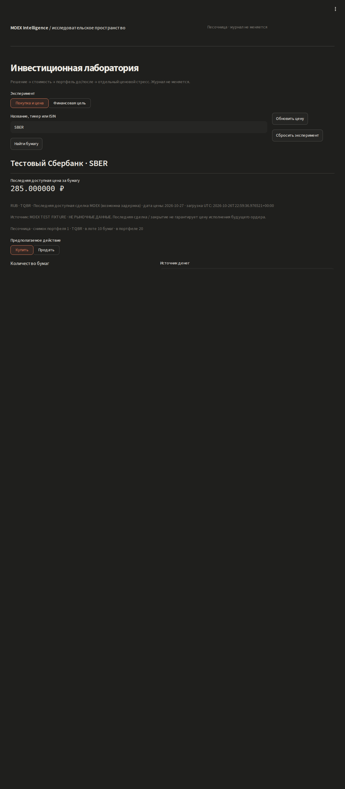
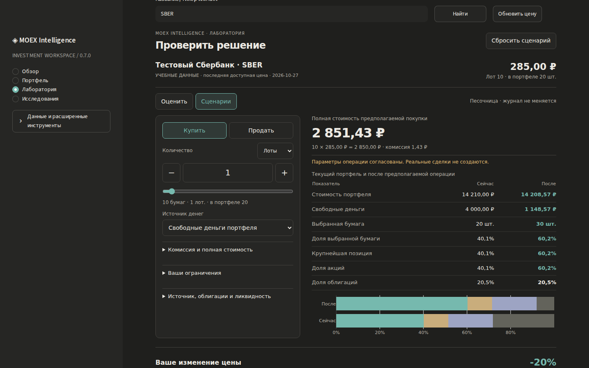
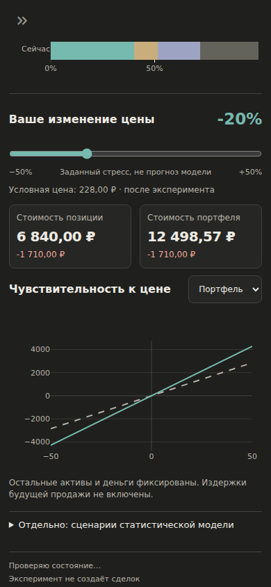

# Проверки MOEX Intelligence v0.7.0

## Результат

- Восстановленная v0.6 до изменений: **163 passed** (baseline-test-results.xml).
- v0.7: **173 passed** (test-results.xml и test-summary.txt). UI-тесты адаптированы к новой навигации; старый фрагмент также остаётся под регрессионными тестами. Новая финансовая обвязка проверяется отдельными тестами контракта и реальным браузером.
- Python 3.12.14; Streamlit 1.66.1; Plotly 6.9.0. Полная тестовая среда: environment.json. Runtime requirements и их хеши сохранены из v0.6.
- Chromium 153.0.8010.0: покупки/продажи, неизвестная комиссия, некратный лот, topup, reset, позиция → оценка без повторного ввода, переход к предполагаемой операции, смена актива, облигация/НКД, отдельная модель, кэш и сохранение, ограничения. Проверено отсутствие изменений журнала после всех этих действий.
- Четыре viewport: 1440×900, 1280×800, 1024×768, 390×844. Нет горизонтальной прокрутки всей страницы/песочницы; ошибок JavaScript: **0**.
- В сценарии изменения количества/стресса/горизонта реальная функция подготовки тестовой истории вызвана **1 раз**. Модельные карточки не меняются от ценового стресса.
- MCP: subprocess HTTP health, initialize/list/call, 15 инструментов, ошибка недопустимого тикера и отказ для чужого Host — PASS.
- Linux launcher: start → health → reuse → stop — PASS. Синтаксис всех .command и компиляция Python проверены. Это не проверка физического Mac.

## Финансовые эталоны

| Сценарий | Ожидаемый результат |
|---|---|
| Акция 300 ₽, лот 10, 2 лота, комиссия 0,05% | 20 бумаг, 6 000 ₽ база, 6 003 ₽ полная сумма |
| Те же условия, 3 лота | 9 004,50 ₽ |
| Облигация: 95%, номинал 1 000 ₽, НКД 20 ₽, комиссия минимум 10 ₽ | 980 ₽ |
| 10 SBER по учебной цене 285 ₽, комиссия 0,05% | 2 851,43 ₽; округление HALF_UP |
| Неизвестная комиссия | полная сумма и итог операции не показываются |
| 7 бумаг при лоте 10 | явная ошибка, количество не округляется |
| Продажа сверх остатка | итог операции блокируется |
| Стресс облигации −50% при чистой цене 950 ₽ и НКД 20 ₽ | условная полная цена 495 ₽ |
| Допустимая потеря 10%, заданный стресс позиции −20% | конфликт ограничений независимо от ожидаемой доходности |
| Цель, полученная из capital_goal при 10% | обратный расчёт required_return возвращает 10% |
| Повторный импорт / пополнение / начальные остатки | исходные финансовые и replay-тесты сохранены |

## Отзывчивость

На прогретой Linux/Chromium-сессии: шесть изменений количества, локальные вычисления и обновление Plotly. Медиана input → следующий animation frame: **70.7 мс**, максимум **85.9 мс**. Сырые измерения и ширины компонентов: browser/results.json.

Это измерение быстрой реакции интерфейса, не полного сетевого запроса, не первая загрузка Plotly и не SLA для Mac. Последующее независимое подтверждение Python выполняется после 250 мс спокойного ввода внутри st.fragment. Во время движения ползунка нет загрузки всей истории. Тяжёлая модель запускается только при открытии соответствующего раскрытия, результаты и история кэшируются раздельно.

## Визуальная проверка

Снимки ниже — реальные скриншоты браузера на **явно учебных данных**, не текущие котировки и не пользовательский портфель. Визуально проверены читаемость, двухколоночная композиция, мобильная последовательность, карточки результатов и разделение модели/стресса.

Исходный код v0.6:



v0.7 — параметры и результат:



v0.7 — ценовой стресс на узком экране:



Остальные снимки Обзора, Портфеля и четырёх ширин находятся в browser/. Отдельный исходный HTML одобренного прототипа не сохранился; эти снимки не доказывают попиксельное совпадение с ним.

## Неподтверждённое

Реальная MOEX в этой среде не ответила на SBER / SBMX / SU26238RMFS4 за 10 секунд; ошибки сохранены в LIVE_ATTEMPT.json. Успешного live-пути здесь нет. Рабочее приложение при ошибке не использует QA-fixture. Проверка Safari, Finder и Apple Silicon остаётся отдельной аппаратной проверкой.

## Повторение

```bash
.venv/bin/python -m pytest -q
.venv/bin/python -m scripts.verify_http
# Дополнительный QA, приложению не нужен:
# uv pip install --python .venv/bin/python playwright
.venv/bin/python scripts/verify_v07_browser.py --chromium /path/to/chromium
```

Браузерный скрипт создаёт временный изолированный каталог данных и запускает tests/ui_fixture.py. Production app.py не содержит переключателя на эти данные. Для сравнения с v0.6 добавьте --baseline /path/to/unpacked-v0.6.
